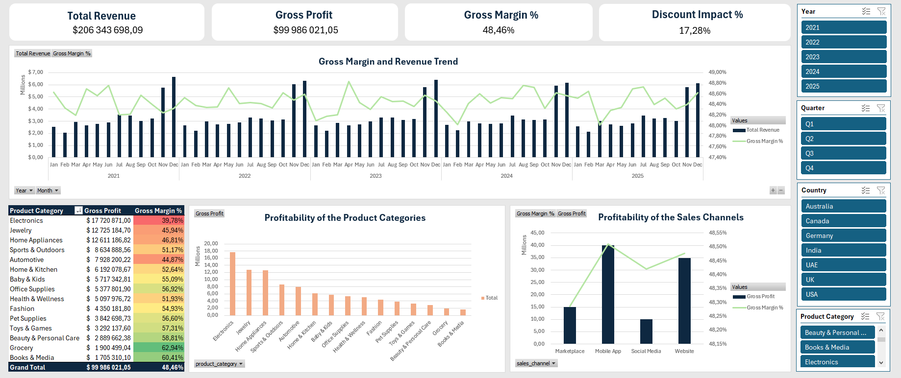
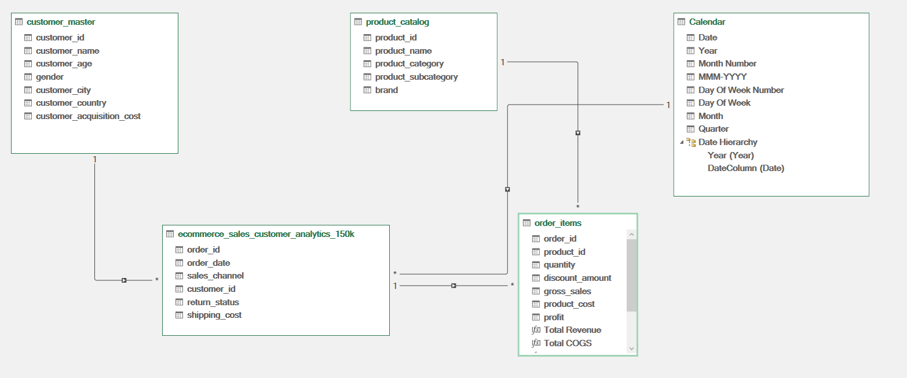
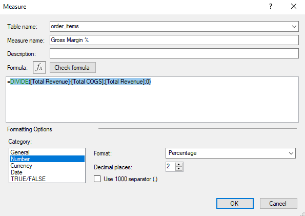

# E-Commerce Financial Performance & Profitability Analysis

## Project Overview
This project focuses on the financial performance of an e-commerce store, transitioning from standard sales metrics to deep profitability analysis. The goal was to identify which product categories and sales channels drive actual cash flow versus those that merely inflate revenue at the cost of margins. 

The entire data modeling, DAX calculations, and interactive dashboard were built using Advanced Excel (Power Query & Power Pivot).

## Tools & Techniques
* **Microsoft Excel:** Advanced formulas, Conditional Formatting.
* **Power Query:** Data extraction, cleaning, and transformation.
* **Power Pivot:** Building a relational Star Schema (Fact and Dimension tables).
* **DAX:** Creating dynamic financial measures (Total Revenue, Gross Profit, Gross Margin %, Discount Impact %).

## Interactive Dashboard
*(Note: You can download the `.xlsx` file from this repository to interact with the slicers and dynamic charts).*

## Executive Summary & Strategic Recommendations

**1. Gross Profit vs. Gross Margin [%] Analysis by Product Category**
* The "Electronics" category generated the highest total Gross Profit of nearly $18M, yet it recorded the lowest Gross Margin at just under 40%.
* Conversely, categories such as "Books & Media" and "Grocery" contributed the lowest total profit (under $2M per category) despite boasting the highest Gross Margins exceeding 60%.

**Business Implication & Strategy:** 
The company heavily relies on sales volume to drive its cash flow. This volume-driven approach poses a significant risk: the low margin in the core category means that any minor increase in costs could easily push it below the break-even point. 
*Recommendation:* Implement a cross-selling strategy that bundles high-volume/low-margin products with high-margin items. Additionally, conduct a price elasticity analysis for the Electronics category; a marginal price increase of just 1-2% could generate millions in additional operating profit without severely impacting demand.

**2. Profitability of Sales Channels**
* The website and mobile application generate the highest gross profit while simultaneously maintaining the highest gross margin exceeding 48%.
* Social media, on the other hand, generate the lowest gross profit (approx. $10M) despite a relatively high margin holding steady at around 48.40%.

**Business Implication & Strategy:** 
Social media marketing attracts high-value customers, but either the advertising budget allocated there is insufficient or the purchasing process is overly complex. 
*Recommendation:* Optimize the purchasing path within the Social Media channel. The company should increase its investment in social media campaigns directing traffic straight to the high-margin mobile application.

**3. Margin Trends and Discount Impact**
* The company forfeits nearly one-fifth of its potential revenue through promotions and discount codes.
* During November and December, record profits are achieved, hovering around $6M per month, with a margin standing at 48.6% since 2022.

**Business Implication & Strategy:** 
The high proportion of discounts is strongly correlated with holiday seasonality and the active loyalty program. 
*Recommendation:* Conduct a cohort analysis to verify whether customers acquired during periods of aggressive holiday promotions return in subsequent months to redeem their points. If so, the current discount policy is a justified customer acquisition cost. If they merely make one-off purchases, the discount allocation rules should be revised to more heavily incentivize repeat transactions.

## Behind the Scenes: Data Architecture
To ensure scalability and performance, the analysis was not built on flat tables. Instead, I developed a relational Data Model and utilized DAX for dynamic metrics.

**Data Model (Star Schema):**

**Dynamic DAX Measures:**

